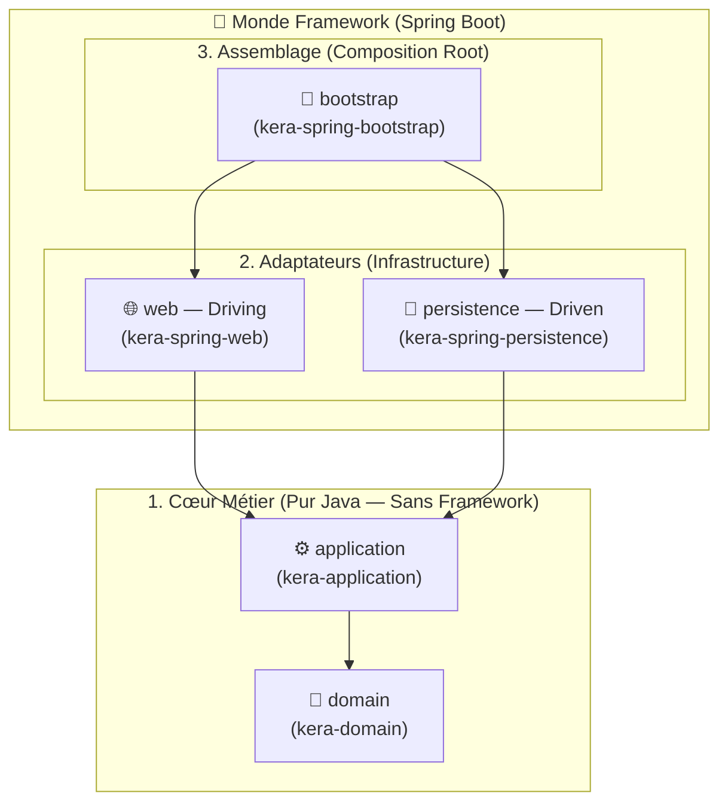

# 🏛️ Kera

🇬🇧 **[English](./README.md)** | 🇫🇷 **Français**

[](https://openjdk.org/projects/jdk/25/)
[](https://spring.io/projects/spring-boot)
[](https://github.com/Felix-Page/kera-demo)
[](./LICENSE)

> **La Clean Architecture en Java / Spring Boot — sans le boilerplate.**

**Kera** (`fr.fpage.kera`) est une boîte à outils d'architecture modulaire et un BOM Maven conçus pour mettre en place une **Clean Architecture stricte** sur des projets Java 25 / Spring Boot 4, tout en éliminant **90 % du code répétitif** (ports CRUD, adaptateurs JPA, mappers MapStruct et résolution de références Hibernate).

Il combine délibérément :
* Les cercles concentriques de la **Clean Architecture** (Robert C. Martin) pour isoler le cœur métier (`domain`) et l'orchestration applicative (`application` : `*UseCase` & `*Interactor`).
* Le pattern **Ports & Adapters / Architecture Hexagonale** (Alistair Cockburn) pour découpler les frontières d'infrastructure (`GenericPort`, `*PersistenceAdapter`, contrôleurs `web`).

---

## 🎯 Pourquoi Kera ?

Appliquer une Clean Architecture stricte avec Spring Boot et JPA se heurte souvent à deux extrêmes :
1. **Le compromis pragmatique mais couplé** : mettre `@Entity` directement sur les objets du Domaine et `@Service` dans l'Application, ce qui couple le cœur métier à Hibernate et Spring.
2. **Le purisme verbeux** : séparer strictement `Domain`, `Entity` et `DTO`, mais devoir réécrire pour chaque entité les mêmes méthodes CRUD, les mêmes adaptateurs JPA, les mêmes mappers et gérer à la main les proxys `@ManyToOne` ou le verrouillage optimiste `@Version`.

**Kera** résout ce dilemme :
* 🔒 **Isolation garantie par le compilateur** : `domain` et `application` sont en **pur Java** (zéro dépendance Spring, JPA ou Jackson).
* ⚡ **Zéro boilerplate d'adaptation** : un adaptateur de persistance complet tient en **6 lignes**, un mapper MapStruct en **3 lignes**.
* 🧠 **Gestion transparente des relations JPA** : résolution automatique des associations par référence sans requêtes `SELECT` superflues en base.

---

## 🏗️ Architecture en 5 Modules

Kera structure votre application en **5 modules Maven** dont les dépendances pointent strictement vers l'intérieur (vers le `domain`) :



| Module Kera | Module Applicatif | Rôle & Briques fournies | Dépendances |
| :--- | :--- | :--- | :--- |
| **`kera-domain`** | `domain` | Classes de base métier immuables : `IdentifiableDomain<ID>`, `AuditableDomain<ID>`, `VersionedDomain<ID>`. | **Aucune (Pur JAVA)** |
| **`kera-application`** | `application` | Port secondaire générique `GenericPort<ID, DOMAIN>` pour les opérations CRUD. | `kera-domain` (**Pur JAVA**) |
| **`kera-spring-persistence`** | `persistence` | Contrats `IdentifiableEntity<ID>`, `AuditableEntity<ID>`, `VersionedEntity<ID>`, `ReferenceableEntity`, `GenericPortImpl`, `AbstractEntityMapper`, `PersistenceMapperConfig`, `JpaEntityResolver`. | Spring Data JPA, Hibernate, MapStruct |
| **`kera-spring-web`** | `web` | Configuration MapStruct `WebMapperConfig`, validation Jakarta et support transactionnel. | Spring Web, Validation, MapStruct |
| **`kera-spring-bootstrap`** | `bootstrap` | Starters d'assemblage Spring Boot, Data JPA, JDBC et Liquibase. | Spring Boot, Liquibase |

---

## 🚀 Installation & Configuration Maven

### 1. Compiler et installer la librairie localement (Alpha)

```bash
git clone https://github.com/Felix-Page/Kera.git
cd Kera
mvn clean install
```

### 2. Importer le BOM Kera dans le `pom.xml` racine de votre projet

Kera n'impose aucun `<parent>` Maven : il s'importe simplement comme un **BOM (`scope: import`)** dans votre `<dependencyManagement>` :

```xml
<properties>
    <kera.version>0.1.0-SNAPSHOT</kera.version>
    <org.mapstruct.version>1.6.3</org.mapstruct.version>
</properties>

<dependencyManagement>
    <dependencies>
        <dependency>
            <groupId>fr.fpage.kera</groupId>
            <artifactId>kera</artifactId>
            <version>${kera.version}</version>
            <type>pom</type>
            <scope>import</scope>
        </dependency>
    </dependencies>
</dependencyManagement>

<build>
    <pluginManagement>
        <plugins>
            <plugin>
                <groupId>org.apache.maven.plugins</groupId>
                <artifactId>maven-compiler-plugin</artifactId>
                <version>3.16.0</version>
                <configuration>
                    <release>25</release>
                    <annotationProcessorPaths>
                        <path>
                            <groupId>org.mapstruct</groupId>
                            <artifactId>mapstruct-processor</artifactId>
                            <version>${org.mapstruct.version}</version>
                        </path>
                    </annotationProcessorPaths>
                </configuration>
            </plugin>
        </plugins>
    </pluginManagement>
</build>
```

---

## 💻 Tour d'horizon couche par couche

### 1. Couche `domain` — Modèle Métier Pur & Auto-Validé

Vos entités métier héritent de `VersionedDomain<ID>` (ou `AuditableDomain<ID>` / `IdentifiableDomain<ID>`). Les métadonnées (`id`, `createdAt`, `updatedAt`, `version`) sont `final` :

```java
public class Ingredient extends VersionedDomain<UUID> {
    private String name;

    // Constructeur unique utilisé par MapStruct pour reconstruire l'objet depuis la base
    public Ingredient(UUID id, LocalDateTime createdAt, LocalDateTime updatedAt, Long version, String name) {
        super(id, createdAt, updatedAt, version);
        this.setName(name);
    }

    // Factory métier pour une nouvelle instance (l'ID sera généré à la persistance)
    public static Ingredient create(String name) {
        return new Ingredient(null, null, null, null, name);
    }

    public String getName() { return name; }

    public void setName(String name) {
        this.validateName(name);
        this.name = name;
    }

    private void validateName(String name) {
        if (name == null || name.isBlank()) {
            throw new IllegalArgumentException("Ingredient name must not be blank");
        }
    }
}
```

### 2. Couche `application` — UseCases & Interactors (Pur Java)

Vos *Interactors* sont de purs POJOs (sans `@Service`) et utilisent directement `GenericPort<ID, DOMAIN>` pour toutes les opérations CRUD (`findById`, `findAll`, `findAllById`, `save`, `saveAll`, `delete`, `deleteById`) :

```java
public interface CreateIngredientUseCase {
    Ingredient execute(String name);
}

public class CreateIngredientInteractor implements CreateIngredientUseCase {
    private final GenericPort<UUID, Ingredient> ingredientPort;

    public CreateIngredientInteractor(GenericPort<UUID, Ingredient> ingredientPort) {
        this.ingredientPort = ingredientPort;
    }

    @Override
    public Ingredient execute(String name) {
        return this.ingredientPort.save(Ingredient.create(name));
    }
}
```

### 3. Couche `persistence` — Contrats d'Entités & Zéro Boilerplate JPA

Dans `kera-spring-persistence`, `IdentifiableEntity<ID>`, `AuditableEntity<ID>` et `VersionedEntity<ID>` sont des **interfaces**. Vous définissez une seule fois la `@MappedSuperclass` de votre projet avec la stratégie de génération d'ID de votre choix :

```java
@MappedSuperclass
public abstract class AbstractEntity implements VersionedEntity<UUID> {
    @Id
    @GeneratedValue(strategy = GenerationType.UUID)
    protected UUID id;
    @Version
    protected Long version;
    @CreationTimestamp
    protected LocalDateTime createdAt;
    @UpdateTimestamp
    protected LocalDateTime updatedAt;
    // Getters & Setters...
}
```

Puis, pour chaque entité autonome (racine d'agrégat), il suffit d'implémenter l'interface marqueur **`ReferenceableEntity`** :

```java
// 1. L'Entité JPA
@Entity(name = "ingredient")
public class IngredientEntity extends AbstractEntity implements ReferenceableEntity {
    @Column(nullable = false, unique = true)
    private String name;
    // Constructeur vide, getter & setter...
}

// 2. Le Repository Spring Data (2 lignes)
@Repository
public interface IngredientJpaRepository extends JpaRepository<IngredientEntity, UUID> {}

// 3. Le Mapper MapStruct (3 lignes — configuré via PersistenceMapperConfig)
@Mapper(config = PersistenceMapperConfig.class)
public interface IngredientEntityMapper extends AbstractEntityMapper<UUID, IngredientEntity, Ingredient> {}

// 4. L'Adaptateur de Persistance (6 lignes — implémente tout GenericPort)
@Service
public class IngredientPersistenceAdapter extends GenericPortImpl<UUID, Ingredient, IngredientEntity, IngredientJpaRepository, IngredientEntityMapper> {
    public IngredientPersistenceAdapter(IngredientJpaRepository repository, IngredientEntityMapper mapper) {
        super(repository, mapper);
    }
}
```

> 💡 **Astuce `ReferenceableEntity` (`@ManyToOne` vs `@OneToMany`)** :
> * Les entités autonomes (ex: `IngredientEntity`, `RecipeEntity`) implémentent `ReferenceableEntity` : lorsqu'elles sont référencées en `@ManyToOne`, `JpaEntityResolver` les attache automatiquement via un proxy Hibernate (`entityManager.getReference()`) **sans exécuter de `SELECT` SQL**.
> * Les sous-entités enfants détenues en composition (`@OneToMany(cascade = CascadeType.ALL)`) n'implémentent **pas** `ReferenceableEntity` : MapStruct mappe alors tous leurs champs sans aucun `@Mapping` manuel.

### 4. Couche `web` — Contrôleurs REST & Records DTO

Les contrôleurs n'exposent jamais les objets du `domain` directement et s'appuient sur `WebMapperConfig` :

```java
public record CreateIngredientRequest(@NotBlank String name) {}
public record IngredientResponse(UUID id, String name) {}

@Mapper(config = WebMapperConfig.class)
public interface IngredientDomainMapper {
    IngredientResponse toResponse(Ingredient ingredient);
}
```

### 5. Couche `bootstrap` — Assemblage (`Composition Root`)

Puisque les *Interactors* de la couche `application` sont de purs POJOs sans annotation Spring, ils sont déclarés comme `@Bean` dans une classe `@Configuration` au sein du module `bootstrap` :

```java
@Configuration
public class InteractorConfig {
    @Bean
    public CreateIngredientUseCase createIngredientUseCase(GenericPort<UUID, Ingredient> ingredientPort) {
        return new CreateIngredientInteractor(ingredientPort);
    }
}
```

---

## 🛠️ Prérequis Techniques

* **Java** : 25
* **Spring Boot** : 4.1.x (Spring Framework 7 / Hibernate 7.4 / Jakarta Persistence 3.2)
* **MapStruct** : 1.6.x
* **Maven** : 3.9+

---

## 🍳 Projet de Démonstration (Showcase)

Pour explorer Kera sur une application de démonstration, consultez le dépôt officiel :  
👉 **[Felix-Page/kera-demo](https://github.com/Felix-Page/kera-demo)**

---

## 📄 Licence

Ce projet est distribué sous licence **Apache 2.0**. Consultez le fichier [LICENSE](./LICENSE) pour plus d'informations.

