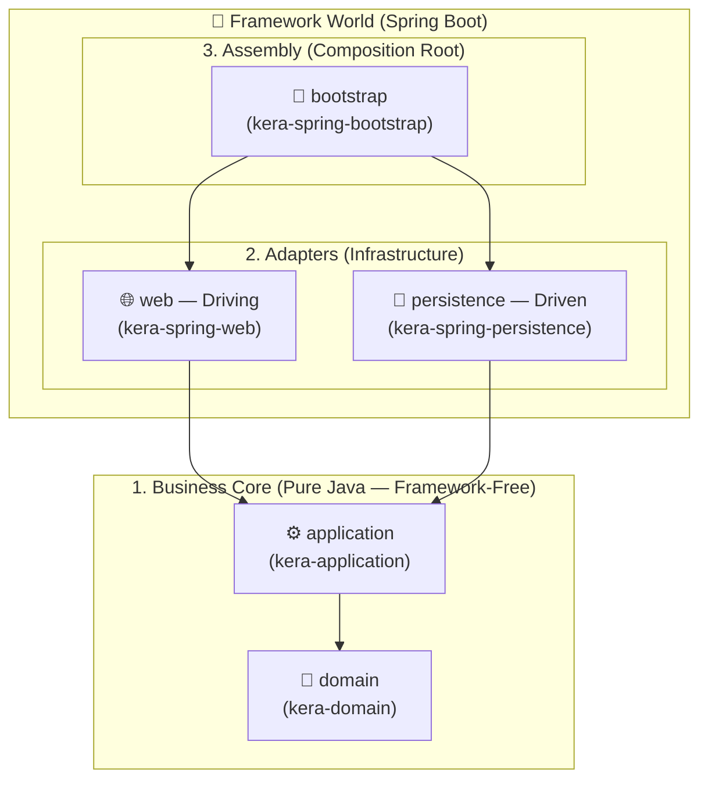

# 🏛️ Kera

🇬🇧 **English** | 🇫🇷 **[Français](./README.fr.md)**

> **Clean Architecture in Java / Spring Boot — without the boilerplate.**

**Kera** (`fr.fpage.kera`) is a lightweight modular framework and Maven BOM designed to enforce **strict Clean Architecture** on Java 25 / Spring Boot 4 projects, while eliminating **90% of the repetitive boilerplate** (CRUD ports, JPA adapters, MapStruct mappers, and Hibernate reference resolution).

It deliberately combines:
* The concentric circles of **Clean Architecture** (Robert C. Martin) to isolate the business core (`domain`) and application orchestration (`application`: `*UseCase` & `*Interactor`).
* The **Ports & Adapters / Hexagonal Architecture** pattern (Alistair Cockburn) to decouple infrastructure boundaries (`GenericPort`, `*PersistenceAdapter`, `web` controllers).

---

## 🎯 Why Kera?

Implementing strict Clean Architecture with Spring Boot and JPA often falls into one of two extremes:
1. **The pragmatic but coupled compromise**: putting `@Entity` directly on Domain objects and `@Service` inside Application classes, tightly coupling the business core to Hibernate and Spring.
2. **Verbose purism**: strictly separating `Domain`, `Entity`, and `DTO`, at the cost of rewriting the exact same CRUD methods, JPA adapters, and mappers for every entity, while manually handling `@ManyToOne` proxies and `@Version` optimistic locking.

**Kera** resolves this dilemma:
* 🔒 **Compiler-enforced isolation**: `domain` and `application` are written in **pure Java** (zero Spring, JPA, or Jackson dependencies).
* ⚡ **Zero adapter boilerplate**: a complete persistence adapter takes **6 lines**, a MapStruct mapper takes **3 lines**.
* 🧠 **Transparent JPA relationship handling**: automatic reference resolution for associations without superfluous `SELECT` queries.

---

## 🏗️ 5-Module Architecture

Kera structures your application into **5 Maven modules** whose dependencies point strictly inward (toward `domain`):



| Kera Module | Application Module | Role & Provided Building Blocks | Dependencies |
| :--- | :--- | :--- | :--- |
| **`kera-domain`** | `domain` | Immutable domain base classes: `IdentifiableDomain<ID>`, `AuditableDomain<ID>`, `VersionedDomain<ID>`. | **None (Pure JAVA)** |
| **`kera-application`** | `application` | Generic secondary port `GenericPort<ID, DOMAIN>` for standard CRUD operations. | `kera-domain` (**Pure JAVA**) |
| **`kera-spring-persistence`** | `persistence` | Contracts `IdentifiableEntity<ID>`, `AuditableEntity<ID>`, `VersionedEntity<ID>`, `ReferenceableEntity`, `GenericPortImpl`, `AbstractEntityMapper`, `PersistenceMapperConfig`, `JpaEntityResolver`. | Spring Data JPA, Hibernate, MapStruct |
| **`kera-spring-web`** | `web` | MapStruct configuration `WebMapperConfig`, Jakarta validation, and transactional support. | Spring Web, Validation, MapStruct |
| **`kera-spring-bootstrap`** | `bootstrap` | Spring Boot, Data JPA, JDBC, and Liquibase assembly starters. | Spring Boot, Liquibase |

---

## 🚀 Installation & Maven Setup

### 1. Build and install the library locally (Alpha)

```bash
git clone https://github.com/Felix-Page/Kera.git
cd Kera
mvn clean install
```

### 2. Import the Kera BOM in your project's root `pom.xml`

Kera does not force a Maven `<parent>`: simply import it as a **BOM (`scope: import`)** inside your `<dependencyManagement>`:

```xml
<properties>
    <kera.version>0.1.0-SNAPSHOT</kera.version>
    <org.mapstruct.version>1.6.3</org.mapstruct.version>
</properties>

<dependencyManagement>
    <dependencies>
        <dependency>
            <groupId>fr.fpage.kera</groupId>
            <artifactId>kera</artifactId>
            <version>${kera.version}</version>
            <type>pom</type>
            <scope>import</scope>
        </dependency>
    </dependencies>
</dependencyManagement>

<build>
    <pluginManagement>
        <plugins>
            <plugin>
                <groupId>org.apache.maven.plugins</groupId>
                <artifactId>maven-compiler-plugin</artifactId>
                <version>3.16.0</version>
                <configuration>
                    <release>25</release>
                    <annotationProcessorPaths>
                        <path>
                            <groupId>org.mapstruct</groupId>
                            <artifactId>mapstruct-processor</artifactId>
                            <version>${org.mapstruct.version}</version>
                        </path>
                    </annotationProcessorPaths>
                </configuration>
            </plugin>
        </plugins>
    </pluginManagement>
</build>
```

---

## 💻 Layer-by-Layer Walkthrough

### 1. `domain` Layer — Pure & Self-Validating Business Model

Your business entities extend `VersionedDomain<ID>` (or `AuditableDomain<ID>` / `IdentifiableDomain<ID>`). Metadata fields (`id`, `createdAt`, `updatedAt`, `version`) are `final`:

```java
public class Ingredient extends VersionedDomain<UUID> {
    private String name;

    // Single public constructor used by MapStruct to reconstruct the object from persistence
    public Ingredient(UUID id, LocalDateTime createdAt, LocalDateTime updatedAt, Long version, String name) {
        super(id, createdAt, updatedAt, version);
        this.setName(name);
    }

    // Domain factory for new instances (ID will be generated upon persistence)
    public static Ingredient create(String name) {
        return new Ingredient(null, null, null, null, name);
    }

    public String getName() { return name; }

    public void setName(String name) {
        this.validateName(name);
        this.name = name;
    }

    private void validateName(String name) {
        if (name == null || name.isBlank()) {
            throw new IllegalArgumentException("Ingredient name must not be blank");
        }
    }
}
```

### 2. `application` Layer — UseCases & Interactors (Pure Java)

Your *Interactors* are pure POJOs (no `@Service`) and directly use `GenericPort<ID, DOMAIN>` for standard CRUD operations (`findById`, `findAll`, `findAllById`, `save`, `saveAll`, `delete`):

```java
public interface CreateIngredientUseCase {
    Ingredient execute(String name);
}

public class CreateIngredientInteractor implements CreateIngredientUseCase {
    private final GenericPort<UUID, Ingredient> ingredientPort;

    public CreateIngredientInteractor(GenericPort<UUID, Ingredient> ingredientPort) {
        this.ingredientPort = ingredientPort;
    }

    @Override
    public Ingredient execute(String name) {
        return this.ingredientPort.save(Ingredient.create(name));
    }
}
```

### 3. `persistence` Layer — Entity Contracts & Zero JPA Boilerplate

In `kera-spring-persistence`, `IdentifiableEntity<ID>`, `AuditableEntity<ID>`, and `VersionedEntity<ID>` are **interfaces**. You define your project's `@MappedSuperclass` once with your preferred ID generation strategy:

```java
@MappedSuperclass
public abstract class AbstractEntity implements VersionedEntity<UUID> {
    @Id
    @GeneratedValue(strategy = GenerationType.UUID)
    protected UUID id;
    @Version
    protected Long version;
    @CreationTimestamp
    protected LocalDateTime createdAt;
    @UpdateTimestamp
    protected LocalDateTime updatedAt;
    // Getters & Setters...
}
```

Then, for each autonomous entity (Aggregate Root), simply implement the **`ReferenceableEntity`** marker interface:

```java
// 1. The JPA Entity
@Entity(name = "ingredient")
public class IngredientEntity extends AbstractEntity implements ReferenceableEntity {
    @Column(nullable = false, unique = true)
    private String name;
    // No-arg constructor, getter & setter...
}

// 2. The Spring Data Repository (2 lines)
@Repository
public interface IngredientJpaRepository extends JpaRepository<IngredientEntity, UUID> {}

// 3. The MapStruct Mapper (3 lines — configured via PersistenceMapperConfig)
@Mapper(config = PersistenceMapperConfig.class)
public interface IngredientEntityMapper extends AbstractEntityMapper<UUID, IngredientEntity, Ingredient> {}

// 4. The Persistence Adapter (6 lines — implements all of GenericPort)
@Service
public class IngredientPersistenceAdapter extends GenericPortImpl<UUID, Ingredient, IngredientEntity, IngredientJpaRepository, IngredientEntityMapper> {
    public IngredientPersistenceAdapter(IngredientJpaRepository repository, IngredientEntityMapper mapper) {
        super(repository, mapper);
    }
}
```

> 💡 **`ReferenceableEntity` Tip (`@ManyToOne` vs `@OneToMany`)**:
> * Autonomous entities (e.g., `IngredientEntity`, `RecipeEntity`) implement `ReferenceableEntity`: when referenced via `@ManyToOne`, `JpaEntityResolver` automatically attaches them via a Hibernate proxy (`entityManager.getReference()`) **without executing any `SELECT` SQL query**.
> * Child sub-entities owned via composition (`@OneToMany(cascade = CascadeType.ALL)`) do **not** implement `ReferenceableEntity`: MapStruct maps all their fields without requiring manual `@Mapping` annotations.

### 4. `web` Layer — REST Controllers & DTO Records

Controllers never expose `domain` objects directly and rely on `WebMapperConfig`:

```java
public record CreateIngredientRequest(@NotBlank String name) {}
public record IngredientResponse(UUID id, String name) {}

@Mapper(config = WebMapperConfig.class)
public interface IngredientDomainMapper {
    IngredientResponse toResponse(Ingredient ingredient);
}
```

### 5. `bootstrap` Layer — Assembly (`Composition Root`)

Because *Interactors* in the `application` layer are pure POJOs without Spring annotations, they are wired as `@Bean` definitions inside a `@Configuration` class in the `bootstrap` module:

```java
@Configuration
public class InteractorConfig {
    @Bean
    public CreateIngredientUseCase createIngredientUseCase(GenericPort<UUID, Ingredient> ingredientPort) {
        return new CreateIngredientInteractor(ingredientPort);
    }
}
```

---

## 🛠️ Technical Requirements

* **Java**: 25
* **Spring Boot**: 4.1.x (Spring Framework 7 / Hibernate 7.4 / Jakarta Persistence 3.2)
* **MapStruct**: 1.6.x
* **Maven**: 3.9+
